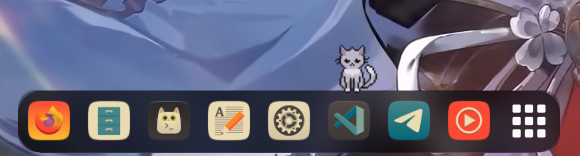

# Dockcat



A little pixel cat that lives on your GNOME dock. It strolls back and forth
across the dock icons, runs, naps, meows, grooms, stretches, plays, and leaps off the ends of the dock before
climbing back up. It only appears while the dock is visible, so it stays out of
the way when you're working in a window.

Designed for a bottom **Dash to Dock**; it measures the dock's app icons to keep
the cat on top of them.

## Features

- A cat that wanders and plays on the dock — walk, run, sit, groom, scratch,
  stretch, loaf, sleep, meow, play.
- Fall-off-the-edge and leap-back-up behaviour.
- Shows only while the dock is on screen.

## Requirements

- GNOME Shell 50.
- A visible dock (built for Dash to Dock at the bottom of the screen).

## Install from source

```sh
make install
```

Then log out and back in, and enable **Dockcat** in the Extensions app.

## Build a zip

```sh
make pack
```

## Credits & license

Code is GPL-2.0-or-later.

The cat sprites are from
[64x64 FREE Pixel Cats animated NPC](https://last-tick.itch.io/animated-pixel-cats-64x64)
by [Last tick](https://last-tick.itch.io/). They are not covered by the GPL and
stay under the artist's own license — see [`CREDITS.md`](CREDITS.md). Please
keep the attribution intact.
